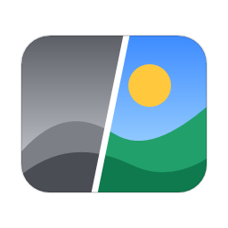
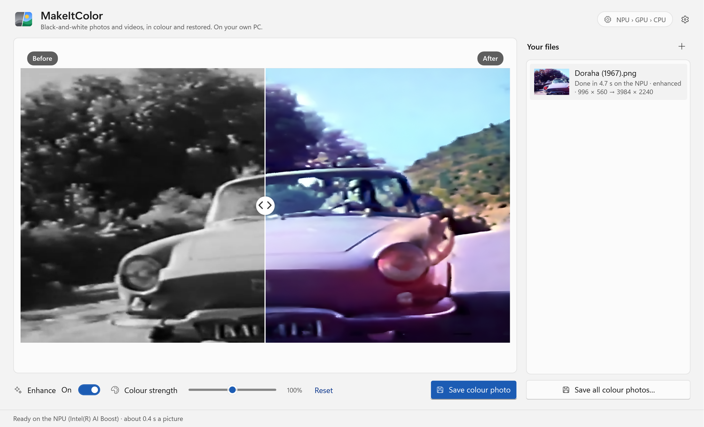

<p align="center"></p>

# MakeItColor

**Black-and-white photos and videos, in colour and cleaned up, on your own PC.** MakeItColor is a free Windows app
that colours old photos and films with the [MakeItColor model](https://huggingface.co/muhammadnoman76/makeitcolor)
(DDColor, ConvNeXt-L) and restores them: it fixes faded brightness and contrast, takes out blur, noise and compression
damage with a small enhancer model (Real-ESRGAN compact), and can make small photos 2× or 4× larger. The models run on
your **NPU first, then your graphics card, then your CPU**, so nothing is uploaded.

Download: **https://www.nomanshafiq.com/makeitcolor/** · Field note: https://www.nomanshafiq.com/blog/makeitcolor/



## What it does
- **Photos**: JPEG, PNG, TIFF, BMP, GIF, WebP, HEIC/HEIF and JPEG XR. Drop files or a whole folder, or choose them.
  Each photo is shown in a before/after view with a divider you can drag (or move with the arrow keys).
- **Colour strength**: a slider from 50 % to 150 % makes the colours softer or more vivid; Reset goes back to what the
  model chose.
- **Fix brightness and contrast** (on by default): faded pictures get deep blacks and clean whites again (an automatic
  levels stretch of at most 1.8×; pictures that already use the whole range are left alone). In videos it follows
  each shot slowly and also takes out the brightness flicker of old film.
- **Enhance photos** (on by default, a switch per photo): the enhancer takes out blur, noise and JPEG damage. Sizes:
  Auto (photos under 2000 pixels become 2× or 4× larger), the original size, 2× or 4×; at most 24 megapixels.
- **Clean up videos**: *Full* runs the enhancer on every frame (on a copy of at most 800 pixels, back to the original
  size, with the detail kept steady where nothing moves); *Light* takes out grain and sharpens gently, fast on any CPU.
  *Auto* uses Full when the enhancer runs on an NPU or graphics card and Light on the CPU.
- **Full size**: the colour model works at 512 × 512, then the colour is put back on the full-size (or enhanced)
  picture, lined up with its edges by a guided filter, so no detail is lost.
- **Videos**: MP4, MOV, MKV, AVI, WMV, WebM, MPEG, M2TS/TS, FLV, 3GP, OGV, VOB and MXF in; an H.264 MP4 out at the
  original size and frame rate, with the original sound, saved next to the original as `name (color).mp4` (or in
  your Videos folder if that folder is read-only). You can stop a video at any time.
- **Steady colours** (videos, on by default): where the picture doesn't change from one frame to the next, the colours
  are kept instead of flickering. A scene cut starts fresh.
- **NPU › GPU › CPU**: Auto uses the best chip it finds; Settings lets you pick one. Every chip is checked with a test
  picture before it's used, and one that gives wrong results is skipped. In Auto the colour model prefers the NPU and
  the enhancer the graphics card, so in videos both work at the same time.
- Saves photos as PNG (lossless) or JPEG (quality 95), at full size, as a new file (`name (color).png`); the originals
  are left as they are.
- Light and dark themes, automatic updates from nomanshafiq.com (Update now, Later, Skip this version).

## Requirements
- Windows 10 version 1903 or newer, or Windows 11; 64-bit Intel/AMD (x64) or ARM64.
- About 1 GB of free space for the colour model, downloaded on first use: 456 MB (NPU and GPU, float16) or 912 MB
  (CPU, float32). Each file is checked against its SHA-256. The enhancer (2.4 MB and 4.9 MB) comes with the app.
- HEIC photos need the *HEIF Image Extensions* from the Microsoft Store (Windows reads them, not the app).

## Speed
Measured on one laptop with an Intel Core Ultra 5 135U (Intel AI Boost NPU, Intel Graphics).

| Model | Chip | Path | Time |
|---|---|---|---|
| Colour (one 512 × 512 run) | NPU (Intel AI Boost) | OpenVINO, float16 | 0.41–0.42 s |
| | GPU (Intel Graphics) | OpenVINO, float16 | 0.51–0.54 s |
| | GPU (Intel Graphics) | DirectML, float16 | 0.77 s |
| | CPU | ONNX Runtime, float32 | 1.8–2.4 s |
| Enhancer (one 256 × 256 tile) | GPU (Intel Graphics) | OpenVINO, float16 | 66–75 ms |
| | NPU (Intel AI Boost) | OpenVINO, float16 | 131 ms (while the NPU was also colouring) |
| | CPU | ONNX Runtime, float32 | 1.0 s |

- A 1500 × 1000 photo enhanced to 3000 × 2000 and coloured: about 3 s with the enhancer on the graphics card (35
  tiles); about 50 s on the CPU alone.
- Videos (1280 × 720 film, 25 fps): about 1.5 frames a second with Full clean-up, 2.2 with Light, on that laptop.
- The first time, the NPU needs about 4–5 minutes to prepare (compile) the colour model and about 15 s for the
  enhancer; after that they load in a few seconds. In Auto, the app starts on the GPU (or CPU) right away and switches
  to the NPU in the background once it's ready.
- Untested: ARM64 hardware (Qualcomm Snapdragon X), AMD and Qualcomm NPUs, NVIDIA and AMD graphics cards. They use
  the same Windows ML code paths and the same correctness checks, but I haven't run them.

## How it works
1. Brightness and contrast are fixed (if on). The picture's lightness (L in CIE Lab) is shrunk to 512 × 512 with an
   antialiased filter; the colour model sees it as a gray picture and predicts the two colour channels (a, b).
2. The enhancer runs tile by tile (256 × 256, overlapping by 24 pixels, which matches running the whole picture at
   once to 87 dB) and each tile's 4× result is resampled straight to the output size. The colour model never sees the
   enhancer's output, so the colours are the same with and without it; the enhanced picture gives the detail.
3. The predicted a/b are enlarged to full size (bilinear) and lined up with the picture's edges by a guided filter
   steered by L, then combined with that L.
4. Both models run through Windows ML (ONNX Runtime). Windows ML fetches the execution providers Windows has certified
   for the PC (Intel OpenVINO on this laptop, which is what makes the NPU usable); DirectML covers any DirectX 12 GPU.
5. Videos are read and written with FFmpeg in five stages that run at the same time: decode; brightness, flicker and
   the model input; enhance; colour (plus steady colours); finish + encode.

Details and the numbers behind every choice: [docs/QUALITY.md](docs/QUALITY.md).

## Build
- .NET 10 SDK and Inno Setup 6.
- `powershell -ExecutionPolicy Bypass -File build.ps1 -Version 1.0.0` publishes x64 and ARM64 (self-contained) and
  writes `dist\MakeItColor-Setup-<version>-<edition>.exe` and `dist\SHA256SUMS.txt`.
- FFmpeg is fetched by `tools\get-ffmpeg.ps1` (pinned zips, SHA-256 checked; see `vendor\ffmpeg\SOURCE.txt`).
- The colour model's ONNX files are made by `tools\model\convert.py` from the original PyTorch checkpoint, the
  enhancer's by `tools\model\enhance.py` from Real-ESRGAN's checkpoints; `tools\model\pipeline.py` is the reference
  the app's colour maths is tested against.

Test without a window:
```
MakeItColor.exe --colorize in.jpg out.png [--processor auto|npu|gpu|cpu] [--vividness 1.0] [--report report.json]
                [--tone on|off] [--enhance on|off] [--size auto|original|double|quadruple] [--no-color]
MakeItColor.exe --colorize in.mp4 out.mp4 [--no-steady] [--quality standard|high|best]
                [--video-enhance auto|full|light|off]
MakeItColor.exe --prepare            # download the colour model and compile it for the NPU
```
`MAKEITCOLOR_MODELS=<folder>` uses local model files. Logs: `%APPDATA%\MakeItColor\info.log` and `error.log`.

## Licence and credits
- MakeItColor © 2026 Muhammad Noman.
- Colour model: [MakeItColor](https://huggingface.co/muhammadnoman76/makeitcolor), based on
  [DDColor](https://github.com/piddnad/DDColor) (Kang et al., ICCV 2023) as packaged in ModelScope, Apache 2.0.
- Enhancer: [Real-ESRGAN](https://github.com/xinntao/Real-ESRGAN) compact general model by Xintao Wang et al.,
  BSD 3-Clause; network definition from [BasicSR](https://github.com/XPixelGroup/BasicSR), Apache 2.0.
- Windows ML / ONNX Runtime (MIT), FFmpeg (LGPL 2.1, unmodified BtbN build), Fluent UI System Icons (MIT).
  See [THIRD-PARTY-NOTICES.txt](THIRD-PARTY-NOTICES.txt).

The colour model guesses plausible colours; it can't know the real ones. Skies, skin, grass and water usually come
out right; clothes, cars and painted walls are often a guess. The enhancer draws plausible detail too: at 4× fine
textures such as rocks and leaves can look slightly painted.
